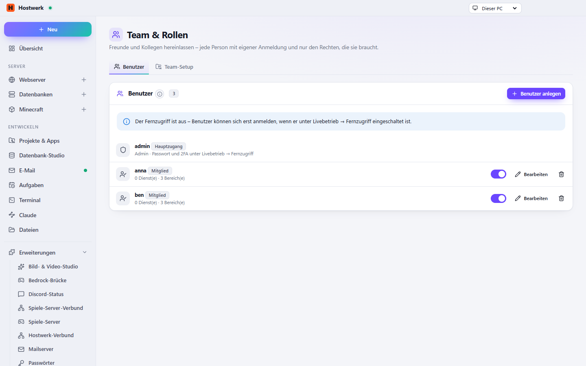

# Team & Rollen

Freunde und Kollegen mit eigener Anmeldung für den Fernzugriff – Mitglieder sehen und steuern nur, was du freigibst. Dazu gemeinsame Team-Einrichtungen aus einem geteilten Ordner.

[English](README.md) · Offizielle [Hostwerk](https://github.com/Passimoritz/hostwerk-public)-Erweiterung (SDK 2.7, native Erweiterung)



## Was sie kann

- Mitglieder mit eigener Anmeldung (Fernzugriff)
- Benutzer-Dialog in vier Schritten (Person, Rolle, Zugriff, Extras) mit Zusammenfassung vor dem Speichern – „Paul darf: Firefight Testserver – starten und stoppen, Konsole … bis 30. Okt.“
- Einzelne Dienste und **Bereiche je Dienst** freigeben (Matrix: Starten/Stoppen, Konsole, Spieler, Sicherungen, Dateien, Protokolle) – mit Vorlagen wie „Freund“ oder „Helfer“
- Mitglieder sehen in der Übersicht nur ihren Teil
- **Einladung per Link** statt Passwort: die Person wählt ihr Passwort selbst; der Link gilt einmal und läuft nach 1 Stunde bis 7 Tagen ab – kopieren, teilen oder als QR-Code zeigen
- **Befristete Rechte** für Helfer auf Zeit – nach dem Enddatum geht weder Anmeldung noch Zugriff
- **Protokoll:** was Mitglieder geändert haben (aus Hostwerks Änderungs-Protokoll) und was sie ohne Berechtigung versucht haben
- Die Rechte-Regeln sind eine verankerte Routen-Tabelle; ein Test liest Hostwerks Routen und schlägt fehl, sobald eine neue Kern-Route keine Entscheidung hat
- **Discord-ID je Mitglied** – der Discord-Bot erlaubt dann genau das, was du hier freigibst
- Team-Einrichtungen aus einem geteilten Ordner
- Anmeldung und Passkeys bleiben in Hostwerk selbst

Für andere Erweiterungen (Dienst `users`, vorher `typeof users.can === 'function'` prüfen – ab 1.2):

```js
users.can(mitgliedId, 'mc:survival', 'start-stop');          // oder { kind: 'minecraft', id: 'survival' } aus Hostwerk.services()
users.byDiscord('123456789012345678');                       // Mitglied mit dieser Discord-ID oder null
```

Seit 1.3 kann ein Mitglied Bereiche je Dienst haben (`serviceAreas: { 'mc:survival': ['start-stop'] }`); ein Dienst ohne Eintrag nutzt die globalen `areas`. `users.can()` beachtet das schon – Rechte also darüber abfragen statt über die gespeicherten Felder.

## Installieren

In Hostwerk unter **Erweiterungen → Entdecken** auf „Installieren“ klicken. Wer die Funktion schon in Hostwerk 2.8 benutzt hat, bekommt die Erweiterung beim Update automatisch – mit allen Daten.

Native Erweiterungen laufen als Teil von Hostwerk (eigener Server- und Oberflächen-Teil). Darum installiert Hostwerk sie nur aus dem offiziellen Katalog (mit Prüfsumme) oder im Entwickler-Modus.

## Daten

`settings.users, settings.team` – genau dort, wo Hostwerk sie schon immer abgelegt hat (Einladungen nur als Prüfsumme). Abgelehnte Versuche in `data/team/denied.json` (die letzten 200). Entfernen der Erweiterung löscht nichts.

## Entwickeln

```bash
node --test tests/*.test.js          # Tests (routes.test.js liest die Routen aus ../hostwerk oder HOSTWERK_DIR)
node build-native.js .               # Oberfläche bauen (sdk/build-native.js aus hostwerk-public)
node check.js . --strict             # Prüfung wie im Katalog (sdk/check.js)
```

Quelltext der Oberfläche in `ui/src`, Server-Teil in `server/`. Texte im Code sind Englisch, Deutsch steht in `locales/de.json`.

## Lizenz

MIT
