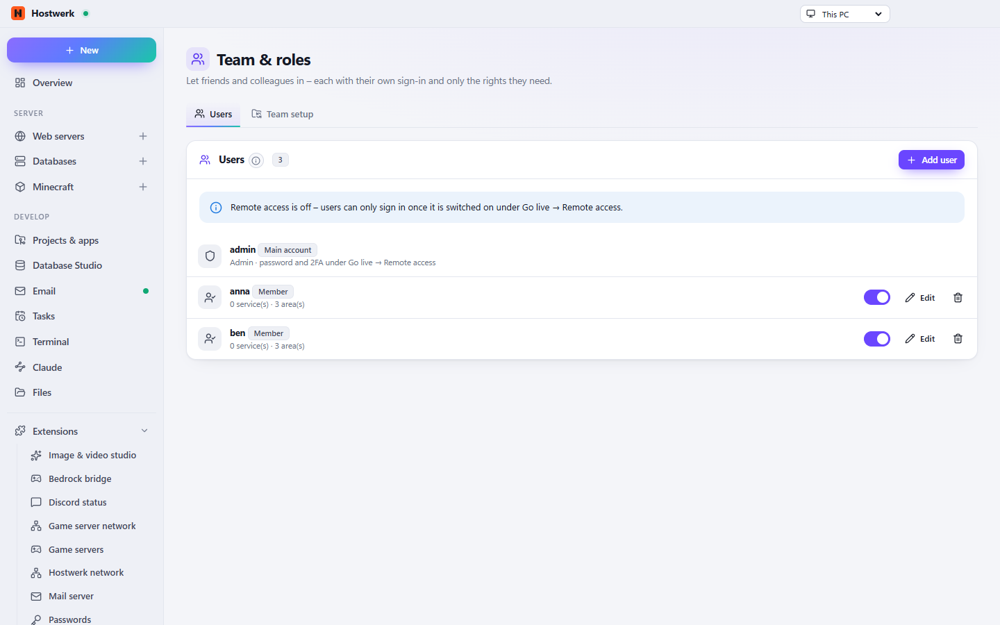

# Team & roles

Friends and colleagues with their own sign-in for remote access – members only see and control what you share. Plus shared team setups from a shared folder.

[Deutsch](README.de.md) · An official [Hostwerk](https://github.com/Passimoritz/hostwerk-public) extension (SDK 2.7, native extension)



## What it does

- Members with their own sign-in (remote access)
- A user dialog in four steps (person, role, access, extras) with a summary before saving – “Paul may: Firefight test server – start and stop, console … until 30 Oct”
- Share single services and **areas per service** (matrix: start/stop, console, players, backups, files, logs) – with templates like “Friend” or “Helper”
- Members only see their own part of the overview
- **Invite by link** instead of a password: the person chooses their own password; the link works once and expires after 1 hour to 7 days – copy it, share it or show the QR code
- **Rights for a limited time** for helpers – after the end date neither sign-in nor access works
- **Activity:** what members changed (from Hostwerk's change log) and what they tried without permission
- The rights rules are an anchored route table; a test reads Hostwerk's routes and fails as soon as a new core route has no decision
- **Discord ID per member** – the Discord bot then allows exactly what you share here
- Team setups from a shared folder
- Sign-in and passkeys stay in Hostwerk itself

For other extensions (service `users`, check with `typeof users.can === 'function'` – since 1.2):

```js
users.can(memberId, 'mc:survival', 'start-stop');            // or { kind: 'minecraft', id: 'survival' } from Hostwerk.services()
users.byDiscord('123456789012345678');                       // member with this Discord ID or null
```

Since 1.3 a member may have areas per service (`serviceAreas: { 'mc:survival': ['start-stop'] }`); a service without an entry uses the global `areas`. `users.can()` already follows this – read the rights through it instead of the stored fields.

## Install

In Hostwerk: **Extensions → Discover** and click “Install”. If you already used this feature in Hostwerk 2.8, the update installs the extension by itself – with all your data.

Native extensions run as part of Hostwerk (own server and interface part). That is why Hostwerk only installs them from the official catalogue (with checksum) or in developer mode.

## Data

`settings.users, settings.team` – exactly where Hostwerk always kept it. Removing the extension deletes nothing.

## Develop

```bash
node --test tests/*.test.js          # tests (routes.test.js reads the routes from ../hostwerk or HOSTWERK_DIR)
node build-native.js .               # build the interface (sdk/build-native.js from hostwerk-public)
node check.js . --strict             # same check as the catalogue (sdk/check.js)
```

Interface source in `ui/src`, server part in `server/`. Texts in the code are English, German is in `locales/de.json`.

## License

MIT
